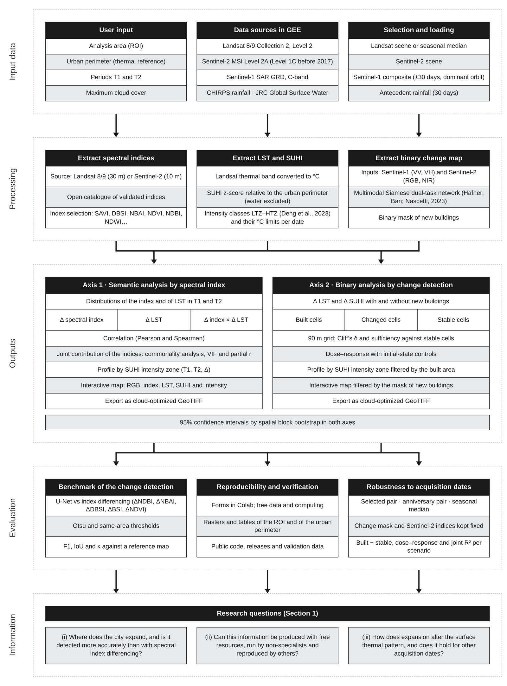
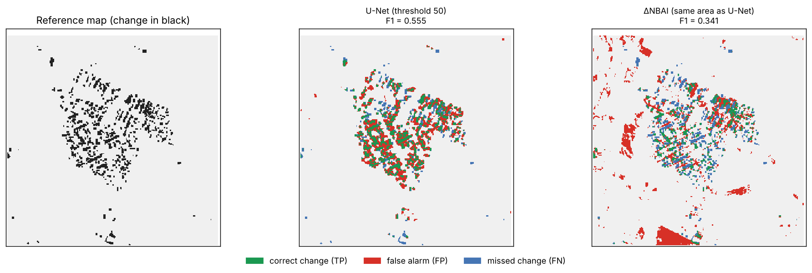

# ThermalAnalisys — v0.11

[](https://doi.org/10.5281/zenodo.23632373)

**An open-source framework that couples deep learning detection of new buildings with intra-urban surface urban heat
island (SUHI) analysis, for cities with limited monitoring infrastructure.**

The framework runs entirely on free cloud resources (Google Earth Engine + Google Colab) through form fields, without
programming. For a city and two periods it answers three practical questions:

1. **Where did the city expand?** New buildings are detected from Sentinel-1 and Sentinel-2 with a pre-trained
   multimodal Siamese U-Net (Hafner, Ban and Nascetti, 2023), which in a semi-arid validation area was far more accurate
   than the spectral-index differencing used by low-cost tools.
2. **How did the surface thermal pattern change?** Landsat land surface temperature (LST) and an intra-urban SUHI
   z-score referenced to the whole urban perimeter, with intensity classes and their °C limits on each date.
3. **Did the new buildings, or other changes, warm the surface — and does it hold for other dates?** Grid contrasts
   between built, changed and stable land, with spatial block bootstrap intervals, repeated for several choices of
   acquisition dates.



---

## Contents

- [What the framework does](#what-the-framework-does)
- [Quick start (Google Colab)](#quick-start-google-colab)
- [Notebook sections](#notebook-sections)
- [Recommended settings](#recommended-settings)
- [Outputs](#outputs)
- [Validation of the change detection](#validation-of-the-change-detection)
- [Repository structure](#repository-structure)
- [Limitations](#limitations)
- [Versions, citation and license](#versions-citation-and-license)
- [References](#references)

---

## What the framework does

| Component | Method | Module |
|---|---|---|
| Image search and selection | Landsat 8, Landsat 9 or both (Collection 2 Level 2); Sentinel-2 L2A (L1C before 28 Mar 2017); Sentinel-1 GRD composite ±30 days around the Sentinel-2 date, dominant orbit; cloud and shadow masking | `image_processing.py` |
| Change detection | Multimodal Siamese dual-task U-Net (S1 VV/VH + S2 B2/B3/B4/B8), pre-trained weights, inference on CPU in tiles of 128 px; probability (0–100) → binary mask of new buildings | `change_detection.py` |
| LST | Landsat ST_B10: `DN × 0.00341802 + 149 − 273.15` (°C), 30 m | `lst_analysis.py` |
| SUHI | z-score `(LST − μ) / σ`, μ and σ over a **thermal reference area** (e.g. the urban perimeter) with permanent water excluded (JRC GSW occurrence ≥ 50 %), intra-urban in the sense of Martin et al. (2015); five intensity classes LTZ–HTZ (Deng et al., 2023) with °C limits per date | `lst_analysis.py`, `visualization.py` |
| Thermal composition | **Selected scenes** (one day per period) or **seasonal median** (per-pixel median of all clear days of a window, one mosaic per day) — the change detection always stays on the selected scenes. Six comparability checks are printed for the median | `thermal_composite.py` |
| Date context | CHIRPS antecedent rainfall (30 days) of every acquisition | `lst_analysis.py` |
| Spectral indices | Any index of the open `spyndex` catalogue (SAVI, DBSI, NBAI, NDVI, NDBI, …) from Landsat (30 m) or Sentinel-2 (10 m) | `spectral_analysis.py` |
| Axis 1 — index analysis | Δ index × Δ LST/Δ SUHI correlations; joint contribution of the indices (commonality analysis, VIF, partial r); profiles by intensity class | `stats_analysis.py`, `zonal_analysis.py` |
| Axis 2 — new buildings | 90 m grid split into **built / changed / stable** cells; built − stable and changed − stable contrasts, Cliff's δ, sufficiency against the natural variation of stable land, dose–response with initial-state controls; 95 % CI by spatial block bootstrap | `stats_analysis.py` |
| Robustness to dates | Selected pair, anniversary pair and seasonal median with the change mask fixed | `robustness.py` |
| Benchmark | U-Net vs differencing of NDBI, NBAI, DBSI, BSI and NDVI (Otsu and same-area thresholds) on the same reference map; F1, IoU, precision, recall, κ | `cd_benchmark.py` |
| Exports | Cloud-optimized GeoTIFFs for the analysis area, the urban perimeter or both; validation package with geometries, metadata and CSV/JSON tables | `export_utils.py`, `validation_export.py` |

---

## Quick start (Google Colab)

### Requirements

- A Google account with Google Drive.
- An **Earth Engine project** (free for non-commercial use): [earthengine.google.com/signup](https://earthengine.google.com/signup/).
- The pre-trained change detection weights `mmcr_train100.pt` of Hafner, Ban and Nascetti (2023):
  [download `mmcr_train100.pt`](https://drive.google.com/file/d/1F2YGSiXeQ801VOT94FCZqxU618j6D3tO/view?usp=drive_link) and place it in `Modelo_Rede_Neural_Change_Detection/` (cell 6.1).
- A KML/KMZ of the analysis area (or draw it in the notebook) and, recommended, a KML of the urban perimeter.

No GPU is needed: the inference of a zone of ~1.6 km² runs on the CPU of a free Colab session.

### Steps

1. **Copy the project to Google Drive**, e.g. `MyDrive/Framework_Analise_Termica/`:

   ```
   Framework_Analise_Termica/
   ├── modulos/                                   ← from this repository
   ├── Pipeline_A_Zone.ipynb                      ← from this repository
   ├── Validation/                                ← from this repository (optional)
   ├── Modelo_Rede_Neural_Change_Detection/
   │   └── mmcr_train100.pt                       ← pre-trained weights
   ├── <analysis_area>.kml / .kmz
   └── <urban_perimeter>.kml
   ```

2. **Open `Pipeline_A_Zone.ipynb` in Colab** and run the cells **in order**. Every cell is a form: fill the fields
   on the right and run.
3. In **cell 1.2**, set the project folder; in **cell 1.3**, enter **your** Earth Engine project ID.
4. Run **6.0** with `Export = Yes`, wait for the Earth Engine tasks to finish
   ([code.earthengine.google.com/tasks](https://code.earthengine.google.com/tasks)), then continue with 6.1–6.5.
5. Export the results in **Section 10**.

If you edit files in `modulos/`, run the cell **🔄 Reload Modules** (no need to restart the runtime).

---

## Notebook sections

| Section | Cells | What you get |
|---|---|---|
| 1 Setup | 1.1–1.3 | Dependencies (tested versions), Drive, Earth Engine authentication |
| 2 Study area | 2.1–2.3 | Analysis area (KML/KMZ or drawn) and **thermal reference area** (urban perimeter) |
| 3 Images | 3.1–3.4 | List of Landsat (8, 9 or 8 + 9) and Sentinel-2 scenes with time and cloud cover; choice of the T1 and T2 scenes |
| 4 Configuration | 4.0 | Site name, UTM zone, Drive export folder |
| 5 LST and SUHI | 5.1–5.2 | Thermal composition (selected scenes or seasonal median + checks), LST, SUHI, class limits in °C, antecedent rainfall |
| 6 Change detection | 6.0–6.6 | Export of S1/S2, U-Net inference, probability → binary mask, integration in Earth Engine, optional benchmark |
| 7 Indices | 7.1 | Catalogue of available spectral indices |
| 8 Δ indices | 8.1, 8.1b, 8.2 | Correlations, joint contribution of the indices, profiles by intensity class |
| 9 New buildings | 9.1, 9.1b, 9.2, 9.3 | Pixels with vs without new buildings, grid analysis (built / changed / stable), profile of new buildings, robustness to dates |
| 10 Export | 10.1–10.4 | Map panel, rasters (ROI / urban perimeter / both), rasters inside the change mask, validation package |

---

## Recommended settings

These are the settings used in the demonstration (Sobral, Brazil, 2019–2025):

| Setting | Value | Why |
|---|---|---|
| Thermal reference (2.3) | Urban perimeter KML | The z-score of a small zone referenced to itself averages 0 on every date; the perimeter makes it intra-urban |
| Image IDs (3.2 / 3.4) | **Keep filled** | They feed the change detection, the configuration that was validated; empty IDs turn every input into a median |
| Thermal composition (5.1) | Seasonal median, Aug–Oct of each year, `L8+L9`, clouds ≤ 10 % | Reduces the weather of a single day (Silva and Torres, 2021) |
| U-Net threshold (6.4) | 45 (model default 50 gives the same F1 on the validation area) | |
| Grid (9.1b) | 90 m cells, built ≥ 50 % new buildings, change indices SAVI and DBSI | Close to the 100 m native thermal resolution |
| Robustness (9.3) | Same windows as 5.1 + anniversary pair | A result is robust when built − stable keeps its sign and its interval excludes 0 in every scenario |

**Conditions to defend a seasonal median** (checked and printed by cell 5.1): (1) the same season, with windows on
the same calendar days; (2) windows of equal length; (3) each window contains the Sentinel-2 date of the change mask;
(4) at least 3 clear days per window and a ratio between periods ≥ 0.5; (5) the same maximum cloud cover; (6) at least
2 valid days per pixel of the analysis area after cloud masking.

---

## Outputs

### Rasters (cell 10.2)

Cloud-optimized GeoTIFFs in the Drive folder of cell 4.0, clipped to their polygon:

- analysis area: `<product>_<site>_t1`, `_t2` and deltas (e.g. `LST_30m_A_Zone_t1`, `Delta_LST_30m_A_Zone`);
- urban perimeter: the same names with `_perimeter` (Landsat products only; Sentinel-1/2 exist only in the analysis area).

Products: LST, SUHI z-score, intensity classes, Landsat bands and indices, Sentinel-2 bands and indices, their
T2 − T1 deltas and the CDI (Δ LST × Δ index). Cell 10.3 exports the same products inside the mask of new buildings.

### Validation package (cell 10.4)

Written to `<project>/Results/<site>/validation_<T1>_<T2>/` (plus a `.zip`) as plain CSV / JSON / GeoJSON:

| File | Content |
|---|---|
| `areas/*.geojson` | Analysis area and urban perimeter (WGS84), with area in km² |
| `run_metadata.json` | Image IDs, dates, CRS, reference mode, thermal composition and its checks, thresholds, version |
| `tables/reference_stats.csv` | μ, σ and °C limits of each SUHI class per date |
| `tables/extent_summary.csv` | LST, SUHI, Δ LST and Δ SUHI statistics for the analysis area and the urban perimeter |
| `tables/class_areas.csv` | km² and share of each intensity class per extent and date |
| `tables/pixel_samples_<extent>.csv` | Random 30 m pixels with every variable, lon/lat and share of new buildings |
| `tables/…` | Tables of the cells that were run: rainfall (5.2), benchmark (6.6), joint regression (8.1b), zonal comparison (9.1), grid cells (9.1b), date robustness (9.3) |

Consistency checks are listed in the package `README.txt` (e.g. the perimeter mean of LST equals μ, and the perimeter
SUHI has mean 0 and standard deviation 1).

---

## Validation of the change detection

The folder [`Validation/`](Validation/README.md) reproduces the accuracy of the change detection and the benchmark
against index differencing without running the whole pipeline (images, model output, reference map and notebook).
Validation area in Sobral, 2016–2023; 77,562 pixels of 10 m inside the reference map, 5.3 % of change:

| Method | F1 [95 % CI] | IoU | κ |
|---|---|---|---|
| U-Net, threshold 50 (model default) | 0.555 [0.513, 0.582] | 0.384 | 0.524 |
| ΔNBAI, same detected area | 0.341 [0.250, 0.406] | 0.206 | 0.296 |
| NBAI post-classification | 0.281 | 0.164 | 0.229 |
| ΔNDBI, Otsu threshold | 0.082 [0.052, 0.115] | 0.043 | −0.018 |



---

## Repository structure

```
├── Pipeline_A_Zone.ipynb        main notebook (Colab forms)
├── modulos/
│   ├── gee_setup.py             Earth Engine authentication
│   ├── image_processing.py      configuration, search, scale factors, cloud masks, Sentinel-1 composites
│   ├── lst_analysis.py          SUHI z-score, intensity classes, antecedent rainfall
│   ├── thermal_composite.py     seasonal median of the thermal data + comparability checks
│   ├── spectral_analysis.py     spectral indices (spyndex)
│   ├── change_detection.py      Siamese U-Net and tiled inference
│   ├── visualization.py         bitemporal processing, statistics and maps
│   ├── stats_analysis.py        joint regression, grid analysis, block bootstrap, Cliff's δ
│   ├── zonal_analysis.py        KML handling, change mask, zonal comparisons and profiles
│   ├── robustness.py            sensitivity to the acquisition dates
│   ├── cd_benchmark.py          U-Net vs index differencing
│   ├── export_utils.py          raster exports (analysis area / urban perimeter)
│   └── validation_export.py     validation package (GeoJSON, JSON, CSV)
├── Validation/                  data, reference map, notebook and expected results of the change detection
├── docs/workflow.png            workflow figure
├── CHANGELOG.md                 versions
├── LICENSE                      MIT License
├── CITATION.cff, .zenodo.json   citation metadata
└── A_Zone.kmz                   analysis area of the demonstration
```

---

## Limitations

- LST is the surface temperature at the morning Landsat overpass, not air temperature or thermal comfort; the 100 m
  native thermal resolution mixes buildings with their surroundings.
- The change detection was validated in one semi-arid area without fine-tuning (F1 0.555); its outputs are areas of
  attention for supervised verification, not a building cadastre. The U-Net was not validated on median composites.
- Differences between dates cannot be fully separated from land-cover change without in situ data; the seasonal
  median and the date scenarios reduce, but do not remove, this uncertainty.
- Results are indicative of how expansion alters the surface thermal pattern, not causal effects.

---

## Versions, citation and license

- Changes between versions: [`CHANGELOG.md`](CHANGELOG.md). Releases are archived on Zenodo: the concept DOI
  [10.5281/zenodo.23632373](https://doi.org/10.5281/zenodo.23632373) cites all versions and always resolves to the latest;
  each version has its own DOI (v0.10: [10.5281/zenodo.23632408](https://doi.org/10.5281/zenodo.23632408);
  v0.11: [10.5281/zenodo.23632662](https://doi.org/10.5281/zenodo.23632662)).
- To cite the software, use the **Cite this repository** button (from [`CITATION.cff`](CITATION.cff)) or the Zenodo record.
- **License:** the code is released under the [MIT License](LICENSE). The pre-trained change detection weights are
  the work of Hafner, Ban and Nascetti (2023) and are not covered by this license; Landsat, Sentinel, CHIRPS and JRC data
  follow the terms of their providers.

---

## References

- Deng, X.; Gao, F.; Liao, S.; Liu, Y.; Chen, W. (2023). Spatiotemporal evolution patterns of urban heat island and its
  relationship with urbanization in Guangdong-Hong Kong-Macao greater bay area of China from 2000 to 2020.
  *Ecological Indicators*, 146, 109817. https://doi.org/10.1016/j.ecolind.2022.109817
- Hafner, S.; Ban, Y.; Nascetti, A. (2023). Semi-supervised urban change detection using multi-modal Sentinel-1 SAR and
  Sentinel-2 MSI data. *Remote Sensing*, 15(21), 5135. https://doi.org/10.3390/rs15215135
- Martin, P.; Baudouin, Y.; Gachon, P. (2015). An alternative method to characterize the surface urban heat island.
  *International Journal of Biometeorology*, 59, 849–861. https://doi.org/10.1007/s00484-014-0902-9
- Pekel, J.-F.; Cottam, A.; Gorelick, N.; Belward, A. S. (2016). High-resolution mapping of global surface water and its long-term changes. *Nature*, 540,
  418–422. https://doi.org/10.1038/nature20584
- Silva, A.; Torres, M. (2021). Proposing an effective and inexpensive tool to detect urban surface temperature changes
  associated with urbanization processes in small cities. *Building and Environment*, 192, 107634.
  https://doi.org/10.1016/j.buildenv.2021.107634
- Corley, I.; Robinson, C.; Ortiz, A. (2024). A change detection reality check. arXiv:2402.06994.
  https://doi.org/10.48550/arXiv.2402.06994
